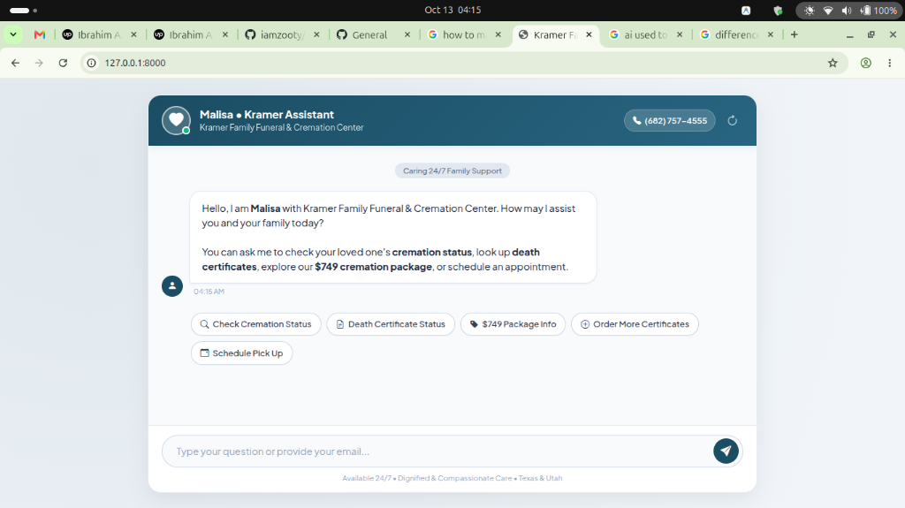
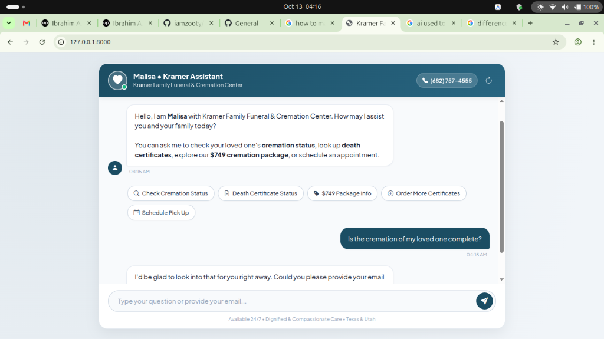

# Kramer AI ("Malisa") — Customer Support & Live Case Tracking Assistant

[](https://www.upwork.com/freelancers/~0190f7e2501c7c5a85)
[](https://www.linkedin.com/in/iamzooty/)
[](https://stackoverflow.com/users/iamzooty)
[](https://www.python.org/)
[](https://www.djangoproject.com/)
[](https://ai.google.dev/)
[](https://monday.com/)

---

> ### 🔒 Client Confidentiality Notice
> **Please Note:** This repository serves as a **portfolio case study and architectural demonstration** of a proprietary commercial project developed for **Kramer Family Funeral & Cremation Center** (*kramerfamilytexas.com*). 
>
> In compliance with client non-disclosure and intellectual property agreements, the full production code repository, internal CRM keys, and proprietary client databases cannot be made public. This showcase provides a transparent, in-depth breakdown of the project's **problem statement, system architecture, technical implementation, and UI design** with verified screenshots.
>
> 📩 **Looking for similar AI or full-stack solutions?** Connect with me on [Upwork](https://www.upwork.com/freelancers/~0190f7e2501c7c5a85) or [LinkedIn](https://www.linkedin.com/in/iamzooty/).

---

## 📌 Project Overview

**Kramer Family Funeral & Cremation Center** is an established funeral home operating across Texas and Utah. Providing affordable cremations (including their signature $749 package) and dignified burials, they operate in a high-touch, emotionally sensitive domain where families require 24/7 empathy, clarity, and rapid reassurance.

**"Malisa"** is an intelligent, compassionate web assistant built to operate as a front-line care representative. She answers general service inquiries, guides families through pre-planning options, and directly interfaces with **Monday.com's CRM** via GraphQL to deliver secure, real-time case status updates on cremation milestones and death certificate filings.

---

## 📸 Visual Showcase

### 1. Welcoming & Accessible Family Interface
*Designed with a calming, comforting palette, prominent 24/7 hotline access, and intuitive suggestion chips for grieving families.*



---

### 2. Intelligent Case Tracking & Automated CRM Lookup
*Demonstrating semantic intent detection: Malisa recognizes a case tracking inquiry, requests verification details (email), and bridges with the backend CRM.*



---

## 🎯 The Problem & Business Challenge

During bereavement, families experience high anxiety and reach out at all hours with critical questions:
1. *"Is the cremation of my loved one complete?"*
2. *"What is the status of the death certificates?"*
3. *"When will the cremation take place?"*
4. *"Can I order additional state death certificates?"*
5. *"Can I change our selected urn or schedule a pickup?"*

### The Operational Pain Points:
* **High Phone Volume**: Care directors were spending hours answering routine operational status checks instead of counseling families.
* **Delayed Off-Hours Updates**: Families calling outside business hours had to wait until the morning for staff to manually inspect boards on Monday.com.
* **Tone Sensitivity**: Generic, robotic chatbot templates felt cold and inappropriate for grieving loved ones.

---

## 💡 The Solution

A robust, enterprise-grade Django web application integrating an advanced Large Language Model with **Monday.com GraphQL API v2**, featuring:

1. **Empathetic AI Conversational Persona**: Calibrated system instructions ensure "Malisa" communicates with gentle, professional warmth, concise answers (<50 words), and appropriate emotional sensitivity.
2. **Deterministic Trigger Identification**: Uses AI similarity classification with temperature controls to reliably map user messages to the exact operational case questions while preventing false positives.
3. **Session-Isolated Authentication & Privacy**: Isolates user requests using Django's secure session layer, collecting email addresses only when needed to query client boards.
4. **Live Monday.com CRM Integration**: Queries live items on board `87610960` by email, extracting specific status milestones (e.g., `@Kramer`, `KC Return Approve`, `Family Submitted Vitals`, `Urn To Mail`) and transforming raw database statuses into compassionate customer updates.
5. **Fail-Safe Fallback Pipeline**: Comprehensive error interception ensuring that even if external APIs face outages or rate limits, the user receives helpful assistance and direct contact details without application crashes.

---

## 🛠️ Architecture & System Design

```
                     ┌──────────────────────────────────┐
                     │          User / Browser          │
                     └─────────────────┬────────────────┘
                                       │ (Async Fetch / CSRF)
                                       ▼
                     ┌──────────────────────────────────┐
                     │       Django Web Application     │
                     └─────────────────┬────────────────┘
                                       │
                  ┌────────────────────┴────────────────────┐
                  ▼                                         ▼
      [Message contains Email]                 [Inquiry / Question]
                  │                                         │
                  │                              ┌──────────┴──────────┐
                  │                              ▼                     ▼
                  │                     [Case Tracking Trigger]  [General FAQ]
                  │                              │                     │
                  │                              ▼                     ▼
                  │                     Store in Session       Generate Guidance
                  │                     Request Email via AI   (Packages, Pricing)
                  │                              │                     │
                  ▼                              └──────────┬──────────┘
      ┌───────────────────────┐                             │
      │  Monday.com CRM API   │                             │
      │ (GraphQL Query by Mail)│                            │
      └───────────┬───────────┘                             │
                  │                                         │
                  ▼                                         │
      ┌───────────────────────┐                             │
      │ Synthesize Status via │                             │
      │ LLM into Gentle Voice │                             │
      └───────────┬───────────┘                             │
                  │                                         │
                  └────────────────────┬────────────────────┘
                                       ▼
                     ┌──────────────────────────────────┐
                     │   Audit / Log to Chat History    │
                     │          (SQLite / ORM)          │
                     └─────────────────┬────────────────┘
                                       ▼
                     ┌──────────────────────────────────┐
                     │   Deliver Polished JSON Bubble   │
                     └──────────────────────────────────┘
```

---

## 💻 Tech Stack & Key Libraries

| Layer | Technology | Role in Project |
| :--- | :--- | :--- |
| **Backend Framework** | **Django 4.x** (Python 3.12) | Core MVC framework, session state handling, REST endpoints, and admin audit dashboard |
| **Artificial Intelligence** | **Google Gemini API** (`google-genai`) | High-speed semantic similarity matching, empathetic prompt generation, and case synthesis |
| **CRM Integration** | **Monday.com GraphQL API v2** | Real-time querying of cremation milestones and death certificate tracking |
| **Frontend & UI** | **HTML5, CSS3, JavaScript (ES6+), Bootstrap 5** | Fully responsive chat interface, quick-action suggestion pills, typing animation, auto-scroll |
| **Data Persistence** | **Django ORM / SQLite** | Complete transcript logging with `Chat` model for quality assurance and compliance |
| **Security & Config** | **python-dotenv** | Environment-based configuration keeping credentials, tokens, and secrets segregated |

---

## 🌟 Key Features & Engineering Highlights

* **Multi-Turn Session State Machine**: Solved concurrency bugs by replacing module-level global variables with thread-safe session tracking. A user's inquiry context is remembered across messages until their email is validated.
* **Resilient Column Parsing**: Replaced fragile static array indexing with dynamic column key mapping (checking title, ID, and index), preventing breaking changes when CRM administrators add or rearrange board columns.
* **High-Converting Quick Action Chips**: Decreases friction for mobile users with 1-tap pills for common workflows (Check Cremation, Death Certificates, $749 Package, Pickups).
* **Database Conversation Logging**: Captures every customer interaction in Django's database with a tailored `ModelAdmin` dashboard featuring search and timestamp filters.
* **Zero-Leak Secret Management**: Fully migrated to `.env` configuration with complete `.gitignore` safeguards.

---

## 📈 Results & Impact

* ⚡ **Instant Status Answers**: Family members receive immediate, accurate updates on their loved one's progress in seconds, day or night.
* 📉 **Reduced Call Center Load**: Significantly curbed incoming repetitive phone inquiries regarding vitals filing and urn shipping status.
* 🤝 **Enhanced Family Peace of Mind**: Delivered a polished, professional digital touchpoint reflecting Kramer's compassionate ethos.

---

## 👨‍💻 About the Developer

I am a Full-Stack Python & AI Engineer specializing in:
* **Custom AI & LLM Applications** (OpenAI, Google Gemini, Anthropic Claude, LangChain, RAG)
* **Python / Django / FastAPI Backend Development**
* **Third-Party API & CRM Integrations** (Monday.com, HubSpot, Salesforce, Stripe, Zapier)
* **Modern, User-Centric Web Interfaces**

### 📬 Connect & Work Together:
* **Upwork**: [freelancers/~0190f7e2501c7c5a85](https://www.upwork.com/freelancers/~0190f7e2501c7c5a85)
* **LinkedIn**: [linkedin.com/in/iamzooty](https://www.linkedin.com/in/iamzooty/)
* **Stack Overflow**: [@iamzooty](https://stackoverflow.com/users/iamzooty)

---

*© Case study prepared for professional portfolio representation. Brand names and assets belong to Kramer Family Funeral & Cremation Center.*
